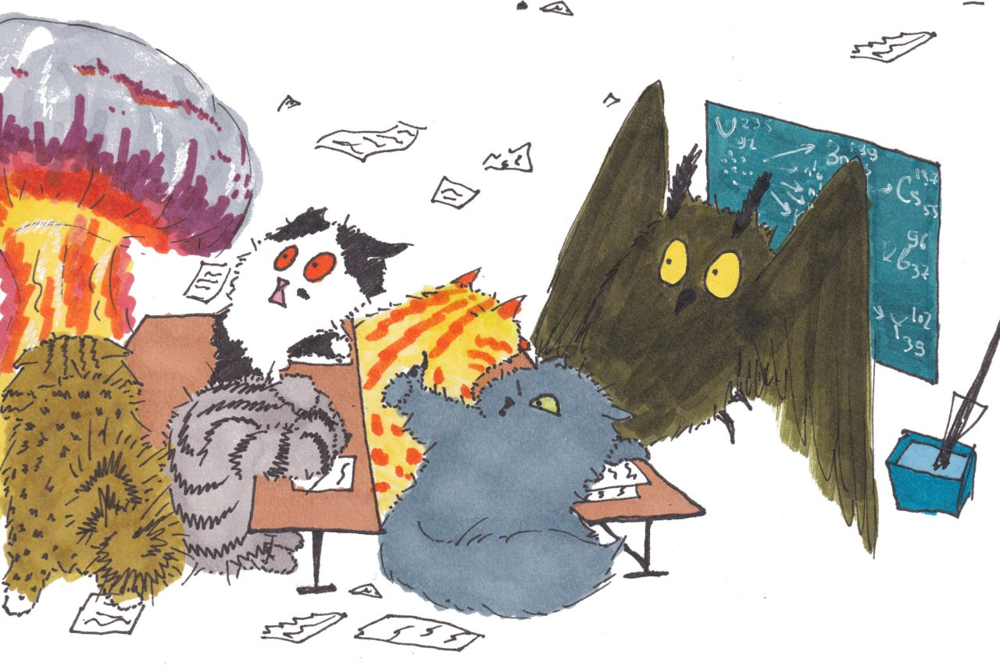

# Лабораторная работа №1

> Изучение системы контроля версий **Git** и хостинга репозиториев **GitHub**

feat. - *https://t.me/this_neural_network/2058*
<details open>
<summary>▶</summary>


<details>
<summary>▶</summary>


<details>
<summary>▶</summary>


<details>
<summary>▶</summary>


<details>
<summary>▶</summary>


<details>
<summary>▶</summary>


<details>
<summary>▶</summary>


</details>
</details>
</details>
</details>
</details>
</details>
</details>

## 👤 Об авторе

| | |
|---|---|
| **ФИО** | Кравченко Иван Антонович |
| **Группа** | 6402-010302D |
| **Направление** | Прикладная математика и информатика |
| **Научный руководитель** | Головашкин Димитрий Львович |
| **Предполагаемая тема ВКР** | Исследование методов распознавания документов с применением языковых моделей |

## 💬 Любимая цитата

> «Мы люди взрослые, поэтому машинки представлять не будем. Будем представлять паровозики!».
>
> — *Головашкин Димитрий Львович, «Основы параллельных вычислений»*

## 🛠 Что сделано в ЛР №1

- [x] Создан публичный репозиторий `web6402-kravchenko_ia`
- [x] Приглашён лектор `teach-kirshdv`
- [x] Создана ветка `lab1`
- [x] Добавлен `Readme.md` с информацией об авторе
- [x] Ветка `lab1` слита с `main` через Pull Request

## Лабораторная работа №2 — HTML и CSS

**Цель:** изучение основ HTML и CSS.

**Тема:** сайт клуба настольных игр «Гильдия».

**Страницы:**
- `index.html` — главная (о клубе, фото)
- `games.html` — каталог игр (таблица)
- `schedule.html` — расписание встреч (таблица), правила клуба
- `contacts.html` — контакты

**Как открыть:** открыть `lab2/index.html` в браузере.

**Выполнение требований:**
- [x] 4 страницы
- [x] блочные и строчные элементы
- [x] ссылки (меню, внешняя, mailto)
- [x] картинки (2 шт.)
- [x] таблицы (2 шт.)
- [x] отдельный файл стилей `css/style.css`
- [x] селекторы: универсальный, тега, класса, id, потомков, дочерних, сестринских, атрибута, псевдокласса
- [x] цвета (название, HEX, rgb)
- [x] выравнивание в таблице: по левому краю, по центру, по правому краю
- [x] без JS и сторонних библиотек

## Лабораторная работа №3 — основы JavaScript

**Цель:** изучение основ JavaScript.

**Задание:** реализовать функции из `lab3/src/core.js` по каркасу [js-tasks](https://github.com/teach-kirshdv/js-tasks) так, чтобы проходили тесты.

**Как запустить:**
```
cd lab3
npm install
npm test
```

**Что сделано:**
- `isInteger` — проверка на целое через `n | 0`
- `even` — чётные от 2 до 20, цикл с шагом 2
- `sumTo` — сумма от 1 до n, цикл
- `recSumTo` — та же сумма, рекурсия
- `factorial` — факториал, цикл
- `isBinary` — степень двойки: делим на 2, пока делится, цикл
- `fibonacci` — n-е число Фибоначчи, цикл
- `getOperationFn` — копит значение между вызовами, замыкание
- `sequence` — генератор арифметической прогрессии, замыкание
- `deepEqual` — глубокое сравнение, рекурсия

**Особенности реализации:**
- `isInteger` — по ТЗ «используя побитовые операторы», а они работают с int32, поэтому верно только в диапазоне ±2^31
- `isBinary` — делением на 2, а не `n & (n - 1)`: побитовый вариант ошибается на дробных и больших числах; степень считаю целой неотрицательной (тест `isBinary(1) === true`)
- `sequence` — «функция генератор» сделана замыканием: «каждый вызов функции генератора возвращает следующий элемент последовательности»
- `deepEqual` — значения сравниваются как в Set/Map: NaN равен NaN
- `deepEqual` — «Учитывать специфичные объекты(такие как Date, RegExp и т.п.) не обязательно», поэтому они не учитываются
